# 💳 Proceso KDD para Detección Automatizada de Fraude, Descubrimiento de Anomalías y Reglas de Decisión

[](LICENSE)
[-8A2BE2?style=for-the-badge)]()
[](https://www.python.org/)
[](https://scikit-learn.org/)
[](https://www.postgresql.org/)
[](https://airflow.apache.org/)
[](https://streamlit.io/)
[](https://www.docker.com/)

> **Proyecto Final Integrador — Minería de Datos y Descubrimiento de Conocimiento (*Data Mining & KDD*)**  
> **Institución:** Centro Universitario de Guadalajara (CUGDL) — Universidad de Guadalajara  
> **Programa Académico:** Licenciatura en Inteligencia Artificial y Ciencia de Datos  
> **Autor:** Roberto Alejandro Chagra Martínez  

---

## 📌 Índice del Proceso KDD
1. [Resumen del Proceso KDD](#1-resumen-del-proceso-kdd)
2. [Arquitectura Metodológica KDD (Diagrama de Flujo)](#2-arquitectura-metodológica-kdd-diagrama-de-flujo)
3. [Etapa 1 KDD: Comprensión del Dominio y del Problema](#3-etapa-1-kdd-comprensión-del-dominio-y-del-problema)
4. [Etapa 2 KDD: Selección de Datos y Prevención de Data Leakage](#4-etapa-2-kdd-selección-de-datos-y-prevención-de-data-leakage)
5. [Etapa 3 KDD: Limpieza de Datos, Imputación y Diagnóstico de Outliers](#5-etapa-3-kdd-limpieza-de-datos-imputación-y-diagnóstico-de-outliers)
6. [Etapa 4 KDD: Transformación e Ingeniería de Características](#6-etapa-4-kdd-transformación-e-ingeniería-de-características)
7. [Etapa 5 KDD: Minería de Datos Híbrida (Isolation Forest + SMOTE + Clasificación)](#7-etapa-5-kdd-minería-de-datos-híbrida-isolation-forest--smote--clasificación)
8. [Etapa 6 KDD: Evaluación de Patrones y Optimización de Costos](#8-etapa-6-kdd-evaluación-de-patrones-y-optimización-de-costos)
9. [Etapa 7 KDD: Interpretación del Conocimiento (5 Reglas de Decisión White-Box)](#9-etapa-7-kdd-interpretación-del-conocimiento-5-reglas-de-decisión-white-box)
10. [Etapa 8 KDD: Puesta en Producción, MLOps e Inferencia Interactiva](#10-etapa-8-kdd-puesta-en-producción-mlops-e-inferencia-interactiva)
11. [Modalidades de Ejecución del Proyecto](#11-modalidades-de-ejecución-del-proyecto)
12. [Documentación Complementaria y Licencia](#12-documentación-complementaria-y-licencia)

---

## 1. Resumen del Proceso KDD

Este repositorio documenta e implementa el ciclo de vida completo de **Knowledge Discovery in Databases (KDD)** sobre el conjunto de datos transaccionales `credit_card_fraud_detection_2026.csv` (**100,000 transacciones** y **43 atributos**).

El objetivo de descubrimiento consiste en **identificar señales débiles de fraude y descubrir patrones anómalos reproducibles** bajo un entorno con **desbalance severo de clases** ($97.945\%$ transacciones legítimas vs. $2.055\%$ fraudulentas), estructurando el conocimiento descubierto en:
* Modelos matemáticos de ensamble con alta capacidad de discriminación.
* Un modelo no supervisado de detección de valores atípicos (*outlier detection*).
* Reglas lógicas determinísticas (*IF-THEN*) directamente auditables y programables en motores bancarios.
* Un pipeline MLOps automatizado con Apache Airflow 3 y una interfaz interactiva de evaluación de transacciones con alertas operativas.

---

## 2. Arquitectura Metodológica KDD (Diagrama de Flujo)

```mermaid
flowchart TD
    K1["Etapa 1: Comprensión del Dominio<br>• 100,000 transacciones x 43 variables<br>• Desbalance 97.95% vs 2.05%<br>• $279,842 USD en pérdidas"] --> K2["Etapa 2: Selección de Datos<br>• Purgado de 6 Identificadores<br>• Eliminación estricta de Data Leakage<br>• Reducción a 35 variables"]
    
    K2 --> K3["Etapa 3: Limpieza y Outliers<br>• Imputación semántica de browser (No_Aplica_Fisico)<br>• Criterio 1.5x IQR Tukey (Lift 3.26x)<br>• Principio: Outlier != Error"]
    
    K3 --> K4["Etapa 4: Transformación<br>• 8 Características Derivadas (Ratios, Z-Score, Riesgo)<br>• Split 80/20 Estratificado Anti-Fuga<br>• log1p + RobustScaler + Chi-Cuadrado (45 vars)"]
    
    K4 --> K5["Etapa 5: Minería de Datos Híbrida<br>• Tarea No Supervisada: Isolation Forest (Lift 3.75x)<br>• Balanceo Sintético: SMOTE (Train)<br>• Tarea Supervisada: 5 Clasificadores"]
    
    K5 --> K6["Etapa 6: Evaluación de Patrones<br>• Paradoja del Accuracy Demostrada<br>• Optimización de umbral por F2-Score (Costo FN)<br>• Curvas ROC-AUC y PR-AUC"]
    
    K6 --> K7["Etapa 7: Interpretación del Conocimiento<br>• Árbol Interpretable en unidades reales<br>• Extracción de 5 Reglas IF-THEN (Lift hasta 16.46x)"]
    
    K7 --> K8["Etapa 8: Puesta en Producción (MLOps)<br>• Orquestación en Apache Airflow 3<br>• Feature Store en PostgreSQL<br>• Simulador Web Streamlit + Despacho de Alertas"]
```



---

## 3. Etapa 1 KDD: Comprensión del Dominio y del Problema

* **El Problema Financiero:** La naturaleza no cooperativa del fraude implica que los defraudadores imitan transacciones cotidianas, generando señales individuales muy débiles.
* **Diagnóstico Cuantitativo del Desbalance:**
  * **Transacciones Legítimas (Clase 0):** $97,945$ operaciones ($97.945\%$).
  * **Transacciones Fraudulentas (Clase 1):** $2,055$ operaciones ($2.055\%$).
  * **Razón de Desbalance:** $1 : 47.66$.
  * **Pérdida Económica Directa:** $\$279,842.20\text{ USD}$ acumulados en fraude no prevenido.
* **Tipologías Descubiertas:** *Card-Not-Present* ($51.3\%$), *Account-Takeover* ($21.8\%$), *Synthetic-Identity* ($15.0\%$) y *Card-Present* ($11.9\%$).

---

## 4. Etapa 2 KDD: Selección de Datos y Prevención de Data Leakage

Para garantizar la validez científica y operativa de los patrones extraídos, se implementó una auditoría estricta de causalidad:
* **Exclusión de Identificadores (6 columnas):** `transaction_id`, `customer_id`, `card_id`, `merchant_id`, `transaction_datetime` y `customer_state`.
* **Prevención de Fuga de Información (*Data Leakage*):**
  * `fraud_type`: Categoría conocida semanas después de la transacción tras la investigación bancaria.
  * `fraud_amount_lost`: Pérdida monetaria contable registrada tras el contracargo ($>0$ exclusivamente si `is_fraud == 1`).
  * *Justificación KDD:* Incluir estas variables otorgaría una métrica perfecta artificial ($F_1 = 1.0$), pero el modelo fracasaría en producción al no disponer de estos datos al momento del pago.
* **Resultado:** Reducción de la matriz a $35$ atributos de entrada legítimos.

---

## 5. Etapa 3 KDD: Limpieza de Datos, Imputación y Diagnóstico de Outliers

### 5.1 Tratamiento de Faltantes sin Sesgo de Selección
* Se detectaron $41,709$ registros con valor nulo en `browser` ($41.71\%$).
* **Auditoría Estructural:** El cruce demostró que el $100\%$ correspondía a operaciones en canales físicos (`In-store` y `ATM`). Eliminar estas filas con `dropna()` habría borrado las compras presenciales (**Sesgo de Selección**).
* **Solución:** Se aplicó **imputación semántica** con la categoría `'No_Aplica_Fisico'`.

### 5.2 Diagnóstico de Outliers mediante Criterio $1.5 \times \text{IQR}$ de Tukey
Se cuantificaron los valores atípicos mediante el rango intercuartílico:

$$\text{IQR} = Q_3 - Q_1, \quad \text{Límite Superior} = Q_3 + 1.5 \times \text{IQR}$$

* **Hallazgo Clave (*Outlier $\neq$ Error*):** En variables como `transactions_last_1h > 2.5` y `amount_vs_avg_ratio > 2.35`, la tasa real de fraude se elevó a más del **$5.5\%$**, representando un **Lift de riesgo de hasta $3.26\times$** respecto a las colas normales.
* **Decisión:** Los valores atípicos **se conservaron íntegramente** por constituir la manifestación estadística del fraude.

---

## 6. Etapa 4 KDD: Transformación e Ingeniería de Características

### 6.1 Nuevas Características de Dominio Financiero (8 Variables)
1. `velocity_tx_ratio_1h_24h`: Aceleración en frecuencia de compras en la última hora vs 24 horas.
2. `velocity_amt_ratio_1h_24h`: Concentración monetaria en la última hora respecto al día.
3. `credit_utilization_ratio`: Proporción del límite de crédito consumido en la transacción.
4. `zscore_amount_30d`: Desviación estandarizada respecto a la media de 30 días del cliente.
5. `security_factors_count`: Nivel de autenticación física (`card_present + used_chip + used_pin`).
6. `is_night_tx`: Indicador binario de horario nocturno crítico ($00:00$ a $04:59\text{ h}$).
7. `is_new_account`: Indicador de cuenta reciente ($\le 90\text{ días}$).
8. `composite_risk_index`: Acumulador de señales débiles concurrentes de fraude.

### 6.2 Protocolo Anti-Leakage y Transformación Numérica
* **Partición Estratificada 80/20:** Se ejecutó la división en $X_{train}$ ($80,000$ filas) y $X_{test}$ ($20,000$ filas) **antes** de ajustar cualquier transformación para blindar el conjunto de prueba.
* **Compresión Logarítmica:** Se aplicó $\ln(1 + \max(0, x))$ sobre montos y distancias asimétricas.
* **Escalamiento Robusto:** Se estandarizaron las características numéricas con `RobustScaler` (usando mediana e IQR).
* **Selección Chi-Cuadrado ($\chi^2$):** Se filtraron las características categóricas y dummies más relevantes, consolidando un vector final optimizado de **45 variables**.

---

## 7. Etapa 5 KDD: Minería de Datos Híbrida (Isolation Forest + SMOTE + Clasificación)

### 7.1 Tarea No Supervisada: Aislamiento de Anomalías (*Isolation Forest*)
* Modelo ajustado con $150$ árboles aleatorios y tasa de contaminación $= 0.035$.
* Identificó transacciones anómalas con una tasa de fraude de **$7.07\%$** frente a **$1.88\%$** en las normales (**Lift de $3.75\times$**).
* Se exportó la meta-característica continua `iso_anomaly_score = -score_samples(X)` hacia el clasificador supervisado.

### 7.2 Balanceo Sintético con SMOTE
* Se aplicó `SMOTE(sampling_strategy=0.30)` **exclusivamente sobre $X_{train}$**, elevando los fraudes de $1,644$ a $23,506$ observaciones sintéticas para permitir que los algoritmos aprendan fronteras de decisión robustas.

### 7.3 Modelos Supervisados Entrenados
Se ajustaron y compararon: *Dummy Classifier (Línea Base)*, *Regresión Logística*, *Árbol de Decisión*, *Random Forest* y *Gradient Boosting*.

---

## 8. Etapa 6 KDD: Evaluación de Patrones y Optimización de Costos

### 8.1 La Paradoja de la Exactitud (*Accuracy Paradox*)
El clasificador *Dummy* obtiene **$97.95\%$ de Accuracy** pero tiene **$0.00\%$ de Recall** ($0$ fraudes prevenidos). La evaluación debe regirse por métricas sobre la clase minoritaria: **Recall**, **PR-AUC** y **$F_2$-Score**.

### 8.2 Calibración de Umbral Sensible al Costo ($F_2$-Score)
Debido a que un Falso Negativo ($FN$) genera pérdida monetaria directa mientras que un Falso Positivo ($FP$) solo produce fricción operativa, se ajustó el umbral $\theta^*$ maximizando el índice $F_2$:

$$F_2 = 5 \cdot \frac{\text{Precision} \cdot \text{Recall}}{4 \cdot \text{Precision} + \text{Recall}}$$

### 8.3 Comparativa Cuantitativa en el Conjunto de Prueba ($N = 20,000$, Fraudes = $411$)

| Algoritmo | Umbral $\theta^*$ | Accuracy | Precision | Recall (Sensibilidad) | F1-Score | ROC-AUC | PR-AUC | Fraudes Detectados (TP) |
| :--- | :---: | :---: | :---: | :---: | :---: | :---: | :---: | :---: |
| **Dummy Baseline** | $0.50$ | $97.95\%$ | $0.00\%$ | $0.00\%$ | $0.0000$ | $0.5000$ | $0.0205$ | $0 / 411$ ($0.0\%$) |
| **Regresión Logística (SMOTE)** | $0.35$ | $89.87\%$ | $9.03\%$ | $43.31\%$ | $0.1495$ | $0.8152$ | $0.0964$ | $178 / 411$ ($43.3\%$) |
| **Árbol de Decisión (SMOTE)** | $0.30$ | $93.67\%$ | $13.49\%$ | $38.44\%$ | $0.1997$ | $0.8103$ | $0.1109$ | $158 / 411$ ($38.4\%$) |
| **Random Forest (SMOTE)** ⭐ | **$0.35$** | **$94.21\%$** | **$15.22\%$** | **$53.53\%$** | **$0.2371$** | **$0.8325$** | **$0.1284$** | **$220 / 411$ ($53.5\%$)** |
| **Gradient Boosting (SMOTE)** | $0.15$ | $93.13\%$ | $12.88\%$ | $40.63\%$ | $0.1956$ | **$0.8379$** | **$0.1369$** | $167 / 411$ ($40.6\%$) |

* ⭐ **Modelo Seleccionado:** **Random Forest** logró la mayor sensibilidad de detección interceptando el **$53.53\%$ de los fraudes reales**.
* **Gradient Boosting** demostró el mayor poder discriminante con un área bajo la curva PR-AUC de **$0.1369$** ($6.68\times$ sobre el azar).

---

## 9. Etapa 7 KDD: Interpretación del Conocimiento (5 Reglas de Decisión White-Box)

A partir de la inducción de árboles interpretables en unidades reales, se validaron **5 reglas de decisión determinísticas** (con tasa base de fraude general de $2.055\%$):

| ID Regla | Condición Lógica (`IF`) | Cobertura | Fraudes Capturados | Precisión | Factor Lift | Acción Bancaria |
| :---: | :--- | :---: | :---: | :---: | :---: | :--- |
| **R1** | `high_risk_country == 1` **AND** `card_present == 0` **AND** `transactions_last_1h >= 3` | $269$ | $91$ | **$33.83\%$** | **$16.46\times$** | **DECLINE:** Bloqueo preventivo inmediato |
| **R2** | `high_risk_country == 1` **AND** `account_age_days <= 90` | $565$ | $131$ | **$23.19\%$** | **$11.28\times$** | **DECLINE:** Autenticación forzosa 3DS / Biométrica |
| **R3** | `transaction_hour <= 4` **AND** `international == 1` **AND** `card_present == 0` | $902$ | $114$ | **$18.70\%$** | **$9.10\times$** | **MANUAL_REVIEW:** Solicitud de Token Dinámico (2FA) |
| **R4** | `amount_vs_avg_ratio > 4.8` **AND** `num_chargebacks_ever >= 2` **AND** `card_present == 0` | $611$ | $62$ | **$24.12\%$** | **$11.74\times$** | **DECLINE:** Bloqueo e investigación de contracargos |
| **R5** | `composite_risk_index >= 5` *(acumulación $\ge 5$ señales concurrentes)* | $2,859$ | $575$ | **$20.11\%$** | **$9.79\times$** | **DECLINE:** Bloqueo por acumulación crítica de riesgo |

---

## 10. Etapa 8 KDD: Puesta en Producción, MLOps e Inferencia Interactiva

La última etapa del proceso KDD consiste en operacionalizar los patrones y modelos descubiertos para su explotación práctica:

### 10.1 Motor de Inferencia Unificado (`src/fraud_engine.py`)
Módulo central reusable que encapsula el preprocesamiento, escalamiento, modelos supervisados/no supervisados y la evaluación de las reglas R1 a R5, emitiendo un veredicto tripartito (`DECLINE`, `MANUAL_REVIEW`, `APPROVE`) y construyendo los payloads de alerta.

### 10.2 Simulador Interactivo y Despacho de Alertas (`app.py`)
Aplicación en **Streamlit** para demostraciones en vivo:
```bash
streamlit run app.py
```
* **Presets de Prueba:** Inyección con 1 clic de escenarios de fraude evidente, transacciones legítimas y anomalías sutiles.
* **Simulación Multi-Canal:** Muestra en tiempo real la **notificación SMS enviada al cliente** y el **payload JSON del Webhook** enviado a sistemas de monitoreo (SOC/SIEM/Slack).
* **Auditoría en Base de Datos:** Monitorea en vivo las transacciones persistidas en PostgreSQL (`raw.transactions` y `raw.predictions`).

### 10.3 Ejecutor por Línea de Comandos (`scripts/simulate_single_transaction.py`)
```bash
python scripts/simulate_single_transaction.py --preset fraud
```

### 10.4 Orquestación Continua con Apache Airflow 3 (Docker Compose)
* **`fraud_simulation_pipeline`:** Micro-lotes cada 5 minutos inyectando y calificando transacciones en PostgreSQL.
* **`fraud_model_retraining_pipeline`:** Reentrenamiento semanal automático para combatir el *Concept Drift*.

```bash
docker compose -f airflow/docker-compose.yaml up -d
```
*(Interfaz web: `http://localhost:8080`, credenciales: `airflow` / `airflow`)*.

---

## 11. Modalidades de Ejecución del Proyecto

### 11.0 Instalación de Dependencias por Sistema Operativo
El proyecto incluye archivos de requerimientos específicos según la plataforma de ejecución:

* **En Windows (PowerShell / CMD):**
  ```powershell
  pip install -r requirements-windows.txt
  ```
  *(Incluye el cliente de Airflow y los conectores nativos de Windows; el clúster de Airflow corre mediante Docker Desktop)*.

* **En Linux / WSL2 / Contenedores:**
  ```bash
  pip install -r requirements-linux.txt
  ```
  *(Incluye Apache Airflow con proveedores de PostgreSQL, Celery y Redis nativos de Linux)*.

* **Instalación Universal:**
  ```bash
  pip install -r requirements.txt
  ```

---

### 11.1 Arquitectura del Repositorio y Modalidades de Ejecución

```text
Deteccion_Automatizada_de_Fraude_Descubrimiento_de_Anomalías_y_Reglas_de_Decisión_Tiempo_Real/
├── app.py                                # Centro de Operaciones Web interactivo (Streamlit)
├── scripts/
│   └── simulate_single_transaction.py    # CLI de evaluación y simulación de alertas unitarias
├── src/
│   ├── fraud_engine.py                   # Motor central de inferencia, reglas R1-R5 y alertas
│   ├── train_and_save.py                 # Pipeline de reentrenamiento de modelos en BD PostgreSQL
│   ├── score_transactions.py             # Pipeline de inferencia por lotes en BD PostgreSQL
│   └── db/
│       └── db_connector.py               # Conector de base de datos SQLAlchemy / Psycopg2
├── airflow/
│   ├── docker-compose.yaml               # Clúster Apache Airflow 3 (Scheduler, Worker, Redis, Postgres)
│   └── dags/
│       ├── dag_fraud_pipeline.py         # DAG de ingesta y simulación transaccional en micro-lotes
│       └── dag_retraining_pipeline.py    # DAG de reentrenamiento programado semanal
├── sql/
│   ├── 01_init_database.sql              # Inicialización de bases de datos
│   ├── 02_create_tables.sql              # Esquema DDL para transacciones, predicciones y auditoría
│   ├── 03_feature_store_and_rules.sql    # Vistas analíticas y Feature Store SQL
│   ├── 04_seed_and_migrate.sql           # Carga inicial y migración de datos
│   └── seed_database.py                  # Script de migración masiva a PostgreSQL
├── models/
│   ├── random_forest_fraud_model.joblib  # Clasificador supervisado serializado
│   ├── isolation_forest_fraud_model.joblib # Detector no supervisado de anomalías
│   ├── scaler.joblib                     # Escalador RobustScaler ajustado
│   └── model_columns.json                # Vector canónico de 45 variables de entrada
├── Datasets/
│   └── credit_card_fraud_detection_2026.csv # Conjunto de datos transaccionales (100k registros)
├── docs/
│   ├── DOCUMENTACION_TECNICA.md          # Memoria técnica matemática y científica del proceso KDD
│   ├── DICCIONARIO_FUNCIONES.md          # Catálogo detallado de funciones, sintaxis y parámetros
│   └── Selección de base de datos.pdf    # Justificación y selección del dataset de estudio
├── results/                              # Gráficas analíticas, curvas ROC/PR e interpretaciones
├── requirements-windows.txt              # Dependencias optimizadas para Windows
├── requirements-linux.txt                # Dependencias optimizadas para Linux / WSL / Docker
├── requirements.txt                      # Archivo unificado multiplataforma
├── .gitignore                            # Exclusión de archivos binarios, caches y temporales
├── LICENSE                               # Licencia MIT de código abierto
└── README.md                             # Documentación principal del repositorio
```

#### Modalidades de Ejecución de la Plataforma:

1. **Modalidad 1 — Centro de Operaciones Web en Tiempo Real (`app.py`):**
   * Interfaz gráfica en Streamlit con métricas en vivo, semáforo de riesgo, matriz de confusión operativa, presets de prueba en 1 clic y simulador de alertas SMS y Webhooks JSON.
   ```bash
   streamlit run app.py
   ```

2. **Modalidad 2 — Evaluación CLI y Simulación Unitaria (`scripts/simulate_single_transaction.py`):**
   * Ejecución por consola de alta velocidad con veredictos instantáneos (`DECLINE`, `MANUAL_REVIEW`, `APPROVE`):
   ```bash
   python scripts/simulate_single_transaction.py --preset fraud
   python scripts/simulate_single_transaction.py --preset normal
   python scripts/simulate_single_transaction.py --amount 3200 --high-risk-country 1
   ```

3. **Modalidad 3 — Orquestación MLOps y Micro-Lotes (`airflow/` y `src/`):**
   * Automatización completa con Apache Airflow 3 en Docker y base de datos PostgreSQL, ejecutando ingestión cada 5 minutos y reentrenamiento semanal de modelos:
   ```bash
   docker compose -f airflow/docker-compose.yaml up -d
   ```

---

## 12. Documentación Complementaria y Licencia

* 📄 **[`docs/DOCUMENTACION_TECNICA.md`](docs/DOCUMENTACION_TECNICA.md)**: Memoria técnica detallada con justificación matemática de las 8 etapas del proceso KDD.
* 📘 **[`docs/DICCIONARIO_FUNCIONES.md`](docs/DICCIONARIO_FUNCIONES.md)**: Catálogo técnico de todas las funciones del repositorio con su descripción, sintaxis de código, parámetros y retornos.
* 📜 **Licencia:** Distribuido bajo los términos de la Licencia **MIT**. Consulta [`LICENSE`](LICENSE) para más detalles.
