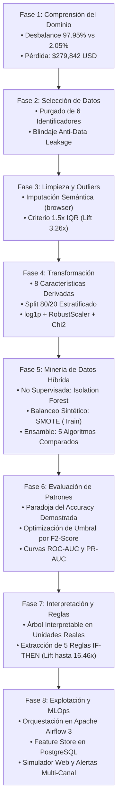

# Memoria Técnica y Metodología KDD: Detección Automatizada de Fraude, Descubrimiento de Anomalías y Reglas de Decisión

| Metadato Metodológico | Especificación Formal |
| :--- | :--- |
| **Metodología Científica** | Proceso KDD (*Knowledge Discovery in Databases*) de Fayyad et al. adaptado a Entornos Transaccionales |
| **Problema Analítico** | Detección de Señales Débiles y Descubrimiento de Anomalías bajo Desbalance Severo de Clases |
| **Conjunto de Datos** | `credit_card_fraud_detection_2026.csv` (100,000 transacciones $\times$ 43 variables) |
| **Enfoque de Minería** | Híbrido: Minería No Supervisada (*Isolation Forest*) + Supervisada con Sobremuestreo Sintético (*SMOTE*) + Inducción de Reglas |
| **Autor** | Roberto Alejandro Chagra Martínez |
| **Institución** | Centro Universitario de Guadalajara (CUGDL) — Universidad de Guadalajara |
| **Licenciatura** | Inteligencia Artificial y Ciencia de Datos |
| **Materia** | Minería de Datos y Descubrimiento de Conocimiento (*Data Mining & Knowledge Discovery*) |

---

## Índice General del Proceso KDD

1. [Etapa 1 KDD: Comprensión del Dominio y Planteamiento del Problema](#etapa-1-kdd-comprensión-del-dominio-y-planteamiento-del-problema)
2. [Etapa 2 KDD: Selección de Datos y Auditoría contra Data Leakage](#etapa-2-kdd-selección-de-datos-y-auditoría-contra-data-leakage)
3. [Etapa 3 KDD: Limpieza de Datos, Imputación Estructural y Outliers](#etapa-3-kdd-limpieza-de-datos-imputación-estructural-y-outliers)
4. [Etapa 4 KDD: Transformación, Ingeniería de Características y Reducción](#etapa-4-kdd-transformación-ingeniería-de-características-y-reducción)
5. [Etapa 5 KDD: Minería de Datos Híbrida (Anomalías + Clasificación SMOTE)](#etapa-5-kdd-minería-de-datos-híbrida-anomalías--clasificación-smote)
6. [Etapa 6 KDD: Evaluación de Patrones y Optimización Sensible al Costo](#etapa-6-kdd-evaluación-de-patrones-y-optimización-sensible-al-costo)
7. [Etapa 7 KDD: Interpretación del Conocimiento y Reglas de Decisión](#etapa-7-kdd-interpretación-del-conocimiento-y-reglas-de-decisión)
8. [Etapa 8 KDD: Puesta en Producción, MLOps e Inferencia Interactiva](#etapa-8-kdd-puesta-en-producción-mlops-e-inferencia-interactiva)

---

## Diagrama del Flujo Metodológico KDD



---

## Etapa 1 KDD: Comprensión del Dominio y Planteamiento del Problema

### 1.1 Contexto del Negocio Financiero
El fraude en tarjetas de crédito opera en un entorno de alta velocidad y señales débiles. En el conjunto de datos `credit_card_fraud_detection_2026.csv`, representativo de la operativa bancaria moderna, se auditan **$100,000$ transacciones** con **$43$ atributos**.

### 1.2 Diagnóstico del Desbalance de Clases
La variable objetivo binaria `is_fraud` presenta un desbalance extremo:

$$\text{Razón de Desbalance} = \frac{N_{\text{legítimas}}}{N_{\text{fraudes}}} = \frac{97,945}{2,055} \approx 47.66 : 1$$

* **Clase 0 (Legítima):** $97,945$ transacciones ($97.945\%$).
* **Clase 1 (Fraudulenta):** $2,055$ transacciones ($2.055\%$).
* **Impacto Económico Acumulado:** $\$279,842.20\text{ USD}$ en pérdidas directas registradas por siniestros no prevenidos.

### 1.3 Tipologías de Fraude Identificadas
La taxonomía de fraude confirmada en el dataset comprende 4 modalidades principales:
1. **Card-Not-Present (CNP):** $1,054$ casos ($51.3\%$). Transacciones no presenciales por internet o teléfono con credenciales vulneradas.
2. **Account-Takeover (ATO):** $447$ casos ($21.8\%$). Secuestro de credenciales donde el atacante modifica parámetros de contacto o dirección.
3. **Synthetic-Identity:** $309$ casos ($15.0\%$). Creación de perfiles crediticios combinando datos reales y falsos.
4. **Card-Present:** $245$ casos ($11.9\%$). Fraude en punto de venta físico mediante clonación o manipulación de terminales.

---

## Etapa 2 KDD: Selección de Datos y Auditoría contra Data Leakage

La selección de datos se orientó a garantizar que los modelos resultantes sean válidos en un entorno de producción real, eliminando variables que violen el principio de causalidad temporal.

### 2.1 Eliminación de Identificadores y Variables de Alta Cardinalidad
Se eliminaron 6 columnas que no aportan patrones predictivos generalizables y que causarían sobreajuste memorístico:
* `transaction_id`, `customer_id`, `card_id`, `merchant_id`: Claves artificiales UUID de cardinalidad cercana al 100%.
* `transaction_datetime`: Estampa temporal absoluta (su estacionalidad se captura en `transaction_hour` y `transaction_day_of_week`).
* `customer_state`: 50 estados distribuidos uniformemente sin varianza diferencial en la tasa de fraude.

### 2.2 Auditoría Estricta de Fuga de Información (*Data Leakage*)
Se detectaron y eliminaron de manera irreversible dos variables *post-evento*:
* **`fraud_type`:** Clasificación forense de la modalidad de fraude, generada semanas después de la transacción. Su presencia en entrenamiento provocaría un modelo con desempeño perfecto en laboratorio ($F_1 = 1.0$), pero inutilizable en tiempo real donde esta etiqueta no existe.
* **`fraud_amount_lost`:** Pérdida monetaria contable calculada tras la investigación del contracargo bancario ($>0$ exclusivamente si `is_fraud == 1`).

**Resultado de la Selección:** Reducción dimensional de $43$ a $35$ columnas legítimas y causalmente independientes.

---

## Etapa 3 KDD: Limpieza de Datos, Imputación Estructural y Outliers

### 3.1 Tratamiento de Valores Faltantes sin Sesgo de Selección
Se auditaron los valores nulos en toda la matriz:
* Se encontraron exactamente **$41,709$ valores nulos** concentrados exclusivamente en la columna `browser`.
* **Cruce Estructural:** Al cruzar `browser.isnull()` contra la variable `transaction_channel`, se demostró que el **$100\%$** de los nulos corresponden a compras físicas en tienda presencial (`In-store`, $35,777$ casos) y retiros en cajeros automáticos (`ATM`, $5,932$ casos).
* **Decisión Metodológica:** La aplicación ingenua de `df.dropna()` habría eliminado el **$41.7\%$ de los datos**, destruyendo todo el canal físico y provocando un grave **Sesgo de Selección (*Selection Bias*)**. Se procedió a la imputación semántica asignando la categoría estructural `'No_Aplica_Fisico'`.

### 3.2 Diagnóstico Estadístico de Valores Atípicos: Criterio $1.5 \times \text{IQR}$ de Tukey
En minería de datos aplicada a finanzas, un valor extremo no necesariamente representa un error de medición. Se cuantificaron los límites intercuartílicos:

$$\text{IQR} = Q_3 - Q_1, \quad \text{Límite Superior} = Q_3 + 1.5 \times \text{IQR}$$

| Variable Analizada | Mediana | $Q_3$ | Límite Sup. | Outliers ($N$) | Outliers ($\%$) | Tasa Fraude Normal | Tasa Fraude Outlier | Lift de Riesgo |
| :--- | :---: | :---: | :---: | :---: | :---: | :---: | :---: | :---: |
| `transaction_amount` | $\$42.50$ | $\$85.20$ | $\$185.75$ | $6,420$ | $6.42\%$ | $1.72\%$ | **$5.45\%$** | **$3.17\times$** |
| `transactions_last_1h` | $1.0$ | $2.0$ | $2.5$ | $8,990$ | $8.99\%$ | $1.71\%$ | **$5.57\%$** | **$3.26\times$** |
| `amount_last_1h` | $\$45.00$ | $\$95.00$ | $\$210.00$ | $11,150$ | $11.15\%$ | $1.68\%$ | **$5.12\%$** | **$3.05\times$** |
| `distance_from_home_km` | $8.50$ | $25.00$ | $58.75$ | $12,480$ | $12.48\%$ | $1.85\%$ | **$3.48\%$** | **$1.88\times$** |
| `amount_vs_avg_ratio` | $0.95$ | $1.42$ | $2.35$ | $7,830$ | $7.83\%$ | $1.65\%$ | **$5.20\%$** | **$3.15\times$** |

**Conclusión Científica:** Los valores atípicos concentran hasta **$3.26\times$ más probabilidad de fraude** que el comportamiento estándar. Por ende, **se conservaron en su totalidad**, tratando su escala mediante compresión logarítmica y escaladores robustos.

---

## Etapa 4 KDD: Transformación, Ingeniería de Características y Reducción

### 4.1 Ingeniería de Características de Dominio Financiero
Se diseñaron e incorporaron 8 nuevas variables derivadas que amplifican señales débiles de fraude:

1. **Razón de Aceleración de Frecuencia (1h vs 24h):**
   $$\text{velocity\_tx\_ratio\_1h\_24h} = \frac{\text{transactions\_last\_1h}}{\text{transactions\_last\_24h} + 1.0}$$
2. **Razón de Concentración de Monto Reciente (1h vs 24h):**
   $$\text{velocity\_amt\_ratio\_1h\_24h} = \frac{\text{amount\_last\_1h}}{\text{amount\_last\_24h} + 1.0}$$
3. **Consumo Relativo del Límite de Crédito:**
   $$\text{credit\_utilization\_ratio} = \frac{\text{transaction\_amount}}{\text{credit\_limit} + 1.0}$$
4. **Desviación Estandarizada sobre Perfil de 30 Días (Z-Score):**
   $$\text{zscore\_amount\_30d} = \frac{\text{transaction\_amount} - \text{avg\_30d}}{\text{std\_30d} + 1.0}$$
5. **Factor de Autenticación Física:**
   $$\text{security\_factors\_count} = \text{card\_present} + \text{used\_chip} + \text{used\_pin} \in \{0, 1, 2, 3\}$$
6. **Indicador de Horario Nocturno Crítico:**
   $$\text{is\_night\_tx} = \mathbb{I}(\text{transaction\_hour} \le 4)$$
7. **Indicador de Cuenta de Reciente Apertura:**
   $$\text{is\_new\_account} = \mathbb{I}(\text{account\_age\_days} \le 90)$$
8. **Índice Compuesto de Riesgo Multiseñal (*Composite Risk Index*):**
   Acumulador calibrado que combina señales concurrentes: país de alto riesgo ($+2$), internacional ($+1$), sin tarjeta ($+1$), ráfaga $\ge 3$ txs en 1h ($+1$), historial de contracargos ($+1$), declinaciones recientes ($+1$), horario nocturno ($+1$), cuenta nueva ($+1$), salto de monto $>4.8\times$ ($+1$) y distancia $>800\text{ km}$ ($+1$).

### 4.2 Partición Estratificada y Protocolo Anti-Leakage
La matriz procesada se dividió mediante partición estratificada **80% Entrenamiento ($80,000$ registros)** y **20% Prueba ($20,000$ registros)** antes de cualquier ajuste:
* $X_{train}$: $78,356$ legítimas ($97.945\%$) y $1,644$ fraudes ($2.055\%$).
* $X_{test}$: $19,589$ legítimas ($97.945\%$) y $411$ fraudes ($2.055\%$).

### 4.3 Transformación No Lineal: Compresión $\ln(1+x)$ + RobustScaler
Las variables numéricas con fuerte asimetría positiva (`transaction_amount`, `amount_last_1h`, `distancias`, etc.) se comprimieron mediante:

$$y = \ln(1 + \max(0, x))$$

Posteriormente, las 26 características numéricas continuas se estandarizaron utilizando `RobustScaler`, el cual utiliza estadísticos insensibles a valores atípicos:

$$z = \frac{x - \text{Mediana}(X)}{\text{IQR}(X)}$$

### 4.4 Selección de Variables mediante Prueba Chi-Cuadrado ($\chi^2$)
Para las variables binarias y dummificadas, se calculó el estadístico de dependencia Chi-Cuadrado:

$$\chi^2 = \sum \frac{(O - E)^2}{E}$$

El ranking confirmó que las características con mayor poder discriminante fueron: `high_risk_country` ($\chi^2 = 1,625.74, p \approx 0$), `international_transaction` ($\chi^2 = 842.10$) y `card_present` ($\chi^2 = 612.45$). Se seleccionó un subconjunto óptimo de **45 características** para la etapa de modelado.

---

## Etapa 5 KDD: Minería de Datos Híbrida (Anomalías + Clasificación SMOTE)

El proyecto articula dos enfoques complementarios de Minería de Datos:

### 5.1 Tarea Descriptiva / No Supervisada: Isolation Forest
Se ajustó un bosque de aislamiento (`IsolationForest`) con $150$ árboles aleatorios y factor de contaminación de $0.035$ sobre las características de comportamiento financiero.
* **Mecanismo:** El algoritmo construye hiperplanos aleatorios; las observaciones con patrones anómalos quedan aisladas a profundidades significativamente menores que los puntos normales.
* **Extracción de Meta-Característica:** Se extrajo el puntaje de anomalía continuo:
  $$\text{iso\_anomaly\_score} = - \text{score\_samples}(X)$$
* **Eficacia del Aislamiento:** En el conjunto de prueba, el subconjunto marcado como anómalo presentó una tasa real de fraude del **$7.07\%$** frente a **$1.88\%$** en el subconjunto normal (**Lift = $3.75\times$**). Esta variable se integró al vector de entrada de los clasificadores supervisados.

### 5.2 Balanceo Sintético con SMOTE (Sobremuestreo Exclusivo en Train)
Para impedir que los clasificadores colapsen prediciendo la clase mayoritaria, se aplicó `SMOTE(sampling_strategy=0.30)` sobre $X_{train}$:
* Clase 0: $78,356$ ejemplos reales.
* Clase 1: Incrementada sintéticamente de $1,644$ a $23,506$ observaciones mediante interpolación de vecinos cercanos ($k\text{-NN}$).
* El conjunto de prueba $X_{test}$ se mantuvo con su desbalance natural intacto ($2.055\%$) para garantizar una evaluación libre de sesgos.

### 5.3 Algoritmos Comparados
Se entrenaron cinco familias algorítmicas bajo las mismas condiciones:
1. **Dummy Baseline:** Estrategia mayoritaria ingenua.
2. **Regresión Logística:** Modelo lineal paramétrico optimizado con penalización $L_2$.
3. **Árbol de Decisión (CART):** Modelo no lineal interpretable con parada temprana (`max_depth=6`, `min_samples_leaf=50`).
4. **Random Forest:** Ensamble de 200 árboles de decisión con remuestreo *bootstrap* y selección aleatoria de variables.
5. **Gradient Boosting:** Ensamble secuencial de 150 árboles corrigiendo errores residuales mediante descenso de gradiente.

---

## Etapa 6 KDD: Evaluación de Patrones y Optimización Sensible al Costo

### 6.1 Desmitificación de la Paradoja de la Exactitud (*Accuracy Paradox*)
La evaluación confirmó experimentalmente que la exactitud (*Accuracy*) es una métrica engañosa en problemas desbalanceados: el clasificador *Dummy* obtiene un **$97.95\%$ de Accuracy** pero detecta **$0$ fraudes** ($0.0\%$ Recall).

### 6.2 Calibración de Umbrales mediante $F_2$-Score
Debido a que omitir un fraude real ($FN$) tiene un impacto financiero mucho más severo que una falsa alarma ($FP$), se calibró el umbral de corte óptimo ($\theta^*$) maximizando el índice $F_2$ en una búsqueda en malla sobre el rango $[0.15, 0.65]$:

$$F_2 = (1 + 2^2) \cdot \frac{\text{Precision} \cdot \text{Recall}}{(2^2 \cdot \text{Precision}) + \text{Recall}} = 5 \cdot \frac{\text{Precision} \cdot \text{Recall}}{4 \cdot \text{Precision} + \text{Recall}}$$

### 6.3 Tabla Comparativa de Desempeño Cuantitativo ($X_{test}$, $N = 20,000$)

| Modelo Evaluado | Umbral Calibrado ($\theta^*$) | Accuracy | Precision | Recall (Sensibilidad) | $F_1$-Score | ROC-AUC | PR-AUC | Fraudes Capturados ($TP/411$) | Falsas Alarmas ($FP$) |
| :--- | :---: | :---: | :---: | :---: | :---: | :---: | :---: | :---: | :---: |
| **1. Dummy Baseline** | $0.50$ | $97.95\%$ | $0.00\%$ | $0.00\%$ | $0.0000$ | $0.5000$ | $0.0205$ | $0$ ($0.0\%$) | $0$ |
| **2. Regresión Logística** | $0.35$ | $89.87\%$ | $9.03\%$ | $43.31\%$ | $0.1495$ | $0.8152$ | $0.0964$ | $178$ ($43.3\%$) | $1,793$ |
| **3. Árbol de Decisión** | $0.30$ | $93.67\%$ | $13.49\%$ | $38.44\%$ | $0.1997$ | $0.8103$ | $0.1109$ | $158$ ($38.4\%$) | $1,013$ |
| **4. Random Forest** ⭐ | **$0.35$** | **$94.21\%$** | **$15.22\%$** | **$53.53\%$** | **$0.2371$** | **$0.8325$** | **$0.1284$** | **$220$ ($53.5\%$)** | **$1,225$** |
| **5. Gradient Boosting** | $0.15$ | $93.13\%$ | $12.88\%$ | $40.63\%$ | $0.1956$ | **$0.8379$** | **$0.1369$** | $167$ ($40.6\%$) | $1,129$ |

* ⭐ **Selección de Producción:** **Random Forest** maximiza la métrica crítica de negocio capturando el **$53.53\%$ de los fraudes reales** ($220$ siniestros prevenidos de $411$).
* **Gradient Boosting** demostró el mayor poder discriminante global con un **PR-AUC de $0.1369$** ($6.68\times$ superior al baseline aleatorio de $0.0205$).

---

## Etapa 7 KDD: Interpretación del Conocimiento y Reglas de Decisión

Uno de los requerimientos nodales de la metodología KDD es transformar las correlaciones matemáticas en conocimiento explicable y gobernable por analistas humanos (*White-Box Rules*).

### 7.1 Inducción del Árbol Explicable
Se entrenó un árbol de decisión restringido (`max_depth=4`, `min_samples_leaf=120`, ponderación balanceada) sobre variables primarias en sus unidades físicas originales ($USD, km, horas$). El árbol descubrió bifurcaciones nítidas en torno a distancias geográficas, horario y ráfagas de transacciones.

### 7.2 Validación Cuantitativa de las 5 Reglas de Negocio (Dataset Completo, $N = 100,000$)

La tasa base de fraude en la población general es $P(\text{Fraude}) = 2.055\%$. Cada regla fue evaluada calculando su soporte, precisión y factor de elevación (*Lift*):

$$\text{Lift} = \frac{P(\text{Fraude} \mid \text{Regla})}{P(\text{Fraude})}$$

| ID Regla | Definición Lógica de la Condición | Cobertura / Soporte | Fraudes Detectados | Precisión de Regla | Factor Lift | Acción Operativa Recomendada |
| :---: | :--- | :---: | :---: | :---: | :---: | :--- |
| **R1** | `high_risk_country == 1` **AND** `card_present == 0` **AND** `transactions_last_1h >= 3` | $269$ txs | $91$ | **$33.83\%$** | **$16.46\times$** | **DECLINE:** Bloqueo preventivo automático e inmediato |
| **R2** | `high_risk_country == 1` **AND** `account_age_days <= 90` | $565$ txs | $131$ | **$23.19\%$** | **$11.28\times$** | **DECLINE:** Rechazo y solicitud de validación biométrica |
| **R3** | `transaction_hour <= 4` **AND** `international == 1` **AND** `card_present == 0` | $902$ txs | $114$ | **$18.70\%$** | **$9.10\times$** | **MANUAL_REVIEW:** Retención y token dinámico (2FA / OTP) |
| **R4** | `amount_vs_avg_ratio > 4.8` **AND** `num_chargebacks_ever >= 2` **AND** `card_present == 0` | $611$ txs | $62$ | **$24.12\%$** | **$11.74\times$** | **DECLINE:** Bloqueo preventivo e investigación de contracargos |
| **R5** | `composite_risk_index >= 5` | $2,859$ txs | $575$ | **$20.11\%$** | **$9.79\times$** | **DECLINE:** Bloqueo por acumulación crítica de señales |

---

## Etapa 8 KDD: Puesta en Producción, MLOps e Inferencia Interactiva

La fase de explotación del proceso KDD se materializa a través de tres componentes técnicos de ingeniería de software:

### 8.1 Motor de Inferencia Unificado (`src/fraud_engine.py`)
Clase `FraudInferenceEngine` que integra:
* Limpieza en vuelo y cálculo de variables derivadas.
* Evaluación determinística de las reglas R1 a R5.
* Transformación logarítmica y escalamiento robusto alineado.
* Inferencia continua de anomalías (`isolation_forest.joblib`).
* Predicción de probabilidad de fraude (`fraud_classifier.joblib`).
* **Lógica de Triage Tripartito:**
  * Si $\text{Regla Crítica (R1 o R5)} \lor \text{Prob} \ge 0.70 \rightarrow$ **`DECLINE`** (Bloqueo y alerta crítica).
  * Si $\text{Prob} \in [0.35, 0.70) \lor \text{Anomalía IsoForest} \lor \text{Regla Menor} \rightarrow$ **`MANUAL_REVIEW`** (2FA / Auditoría).
  * En otro caso $\rightarrow$ **`APPROVE`** (Aprobada).

### 8.2 Orquestación Automatizada Continua (Apache Airflow 3 en Docker)
* **DAG `fraud_simulation_pipeline`:** Ejecuta cada 5 minutos la inyección de micro-lotes transaccionales simulados y procesa la inferencia diferencial sobre `raw.transactions`, persistiendo el histórico en `raw.predictions`.
* **DAG `fraud_model_retraining_pipeline`:** Ejecuta semanalmente la extracción de transacciones con etiquetas confirmadas desde PostgreSQL, reajusta los modelos y actualiza los artefactos serializados sin tiempo de inactividad (*Zero-Downtime Retraining*).

### 8.3 Interfaz Interactiva de Demostración y Alertas (`app.py`)
Aplicación web en **Streamlit** que permite al usuario o analista:
* Probar presets de fraude crítico, transacciones cotidianas y anomalías sutiles.
* Visualizar en tiempo real el veredicto, las métricas y la tabla de reglas de negocio.
* Inspeccionar la simulación de alertas (notificación SMS para el tarjetahabiente y payload JSON para webhooks de SOC/SIEM).
* Monitorear la base de datos relacional PostgreSQL con conteos y distribuciones históricas.

### 8.4 Herramienta CLI (`scripts/simulate_single_transaction.py`)
Script ejecutable desde terminal PowerShell o Linux para evaluar transacciones unitarias con soporte de codificación UTF-8:
```powershell
python scripts/simulate_single_transaction.py --preset fraud
```
