# 🧠 Arquitectura de Inferencia en Tiempo Real en `app.py`: Trazabilidad Interna de una Transacción bajo la Metodología KDD

| Metadato Técnico | Especificación |
| :--- | :--- |
| **Documento** | Memoria de Ejecución Interna del Motor de Inferencia (`app.py` $\leftrightarrow$ `src/fraud_engine.py`) |
| **Metodología Base** | **KDD (*Knowledge Discovery in Databases*)** — 8 Etapas Aplicadas en Tiempo de Inferencia (*Online Scoring*) |
| **Componentes Auditados** | `app.py` (Interfaz Streamlit), `src/fraud_engine.py` (`FraudInferenceEngine`), `models/*.joblib` y PostgreSQL |
| **Institución** | Centro Universitario de Guadalajara (CUGDL) — Universidad de Guadalajara |
| **Programa Académico** | Licenciatura en Inteligencia Artificial y Ciencia de Datos |
| **Autor** | Roberto Alejandro Chagra Martínez |

---

## 1. Introducción: Del Proceso KDD *Offline* a la Inferencia en Tiempo Real (*Online*)

En un sistema bancario de misión crítica, el proceso **KDD (*Knowledge Discovery in Databases*)** se divide en dos planos operativos complementarios:
1. **Plano de Descubrimiento *Offline* (`src/train_and_save.py`):** Procesa el histórico de **100,000 transacciones** ($97.945\%$ legítimas vs. $2.055\%$ fraude) a través de las Etapas 1 a 7 de KDD para descubrir patrones estadísticos, calibrar transformadores libres de fuga de información (*Data Leakage*), inducir reglas de decisión explicables (*White-Box*) y serializar los artefactos matemáticos en el directorio `models/`.
2. **Plano de Explotación en Tiempo Real (`app.py` + `src/fraud_engine.py` — Etapa 8 KDD):** Cada vez que un usuario o analista ingresa una transacción en la interfaz web y presiona el botón **"🚀 Evaluar Transacción & Ejecutar Pipeline de Fraude"**, el sistema ejecuta **en milisegundos** una réplica determinística y exacta de las transformaciones, modelos y reglas descubiertas en las 8 etapas del KDD para emitir un veredicto accionable (`APPROVE`, `MANUAL_REVIEW` o `DECLINE`), despachar alertas multi-canal (SMS y Webhook JSON) y registrar la auditoría en PostgreSQL.

---

## 2. Diagrama de Flujo Interno: ¿Qué ocurre al presionar "Evaluar Transacción" en `app.py`?

```mermaid
flowchart TD
    UI["1. Captura en Interfaz (app.py)<br>• 3 Paneles Interactivos o 5 Presets<br>• Construcción de tx_input (34 atributos pre-evento)<br>• ETAPAS 1 y 2 KDD: Cero Data Leakage"] --> CLEAN["2. Limpieza Estructural en Vuelo<br>preprocess_and_feature_engineering()<br>• Imputación browser -> No_Aplica_Fisico<br>• Conservación íntegra de valores extremos<br>• ETAPA 3 KDD: Sin Sesgo de Selección"]
    
    CLEAN --> FE["3. Ingeniería de 8 Características Derivadas<br>• Ratios de velocidad 1h/24h (frecuencia y monto)<br>• Utilización de crédito y Z-Score a 30 días<br>• Nivel de seguridad física (0-3) e Índice Compuesto (0-11)<br>• ETAPA 4A KDD: Amplificación de Señales Débiles"]
    
    FE --> SCALE["4. Transformación No Lineal y Escalamiento<br>• Compresión logarítmica: ln(1 + max(0, x)) en 6 vars<br>• Estandarización con RobustScaler (scaler.joblib)<br>• Vector canónico de 45 variables (Chi-Cuadrado)<br>• ETAPA 4B KDD: Invarianza a Outliers"]
    
    SCALE --> ISO["5A. Minería No Supervisada (Isolation Forest)<br>• Evalúa 8 variables críticas escaladas<br>• Calcula anomaly_score = -score_samples(X)<br>• Detecta atipicidad (is_anomaly) e inyecta meta-feature<br>• ETAPA 5A KDD: Descubrimiento de Anomalías (Lift 3.75x)"]
    
    CLEAN --> RULES["5B. Motor de Reglas White-Box (R1 a R5)<br>• Evalúa 5 reglas IF-THEN en unidades físicas reales<br>• Identifica reglas críticas (R1, R5) y altas (R2, R3, R4)<br>• ETAPA 7 KDD: Conocimiento Explicable (Lift hasta 16.46x)"]
    
    ISO --> RF["5C. Minería Supervisada (Random Forest + SMOTE)<br>• Ensambla las 45 features (incluyendo iso_anomaly_score)<br>• Evalúa 200 árboles de decisión (fraud_classifier.joblib)<br>• Obtiene probabilidad continua P(Fraude | X)<br>• ETAPA 5B KDD: Clasificación Sensible al Desbalance"]
    
    RULES --> TRIAGE["6. Motor de Decisión Tripartito Sensible al Costo<br>• DECLINE: Regla Crítica (R1/R5) o Prob >= 0.70<br>• MANUAL_REVIEW: Prob >= 0.35 (Óptimo F2), Anomalía o Regla<br>• APPROVE: Prob < 0.35, Normal y 0 Reglas violadas<br>• ETAPAS 6 y 8 KDD: Optimización por F2-Score"]
    RF --> TRIAGE
    
    TRIAGE --> OUT["7. Salida en Interfaz, Alertas y Auditoría SQL<br>• Semáforo de veredicto, 4 KPIs y tabla de reglas R1-R5<br>• Simulación de SMS al cliente y Webhook JSON (SOC/SIEM)<br>• Persistencia en PostgreSQL (raw.transactions y raw.predictions)"]
```

---

## 3. Trazabilidad Paso a Paso dentro del Motor (`app.py` $\rightarrow$ `src/fraud_engine.py`)

### Paso 1: Inicialización en Memoria Compartida y Carga de Artefactos KDD
Al arrancar `app.py`, la función decorada con `@st.cache_resource` (`load_engine()`) instancia una única vez en memoria RAM la clase [`FraudInferenceEngine`](../src/fraud_engine.py). El constructor `__init__` carga los cuatro artefactos generados durante el proceso KDD:
1. **`scaler.joblib` (`RobustScaler`):** Contiene la mediana ($\text{Mediana}_{\text{train}}$) y el rango intercuartílico ($\text{IQR}_{\text{train}}$) exactos de las 26 variables numéricas ajustadas sobre las $80,000$ transacciones de entrenamiento.
2. **`isolation_forest.joblib` (`IsolationForest`):** Bosque no supervisado de 150 árboles ajustado con `contamination=0.035` sobre las 8 variables de mayor sensibilidad conductual.
3. **`fraud_classifier.joblib` (`RandomForestClassifier`):** Ensamble supervisado de 200 árboles entrenado sobre el espacio balanceado con `SMOTE(sampling_strategy=0.30)`.
4. **`model_columns.json`:** Lista ordenada de las **45 características óptimas** seleccionadas mediante la prueba estadística Chi-Cuadrado ($\chi^2$) y el análisis de importancia Gini.

---

### Paso 2: Captura de la Transacción Entrante y Blindaje Anti-*Data Leakage* (Etapas 1 y 2 KDD)

En la **Pestaña 1 (`⚡ Simulador y Despacho de Alertas`)** de `app.py`, el usuario configura los parámetros de la transacción mediante tres columnas temáticas (*Detalles Financieros*, *Ratios de Velocidad y Ubicación*, y *Factores de Seguridad y Entorno*) o selecciona uno de los 5 escenarios preconfigurados en la barra lateral.

Con estos valores, `app.py` construye el diccionario `tx_input` con **34 atributos observables en el instante exacto del pago ($t_0$)**.

> **Aplicación de la Etapa 2 KDD (Prevención de Fuga de Información en Producción):**
> * `tx_input` **no incluye ni solicita** variables *post-evento* como `fraud_type` o `fraud_amount_lost`, ya que en la operativa bancaria real estos datos solo existen semanas después tras el dictamen de un contracargo.
> * Tampoco alimenta al modelo con claves primarias (`transaction_id`, `customer_id`, `card_id`, `merchant_id`). El `transaction_id` (`TXN-XXXXXXXX`) se genera exclusivamente para trazabilidad de auditoría y despacho de alertas, pero se excluye del vector matemático de predicción.

---

### Paso 3: Limpieza Estructural e Imputación Semántica en Vuelo (Etapa 3 KDD)

Cuando el usuario hace clic en **"🚀 Evaluar Transacción"**, `app.py` invoca `result = engine.predict(tx_input)`. La primera operación interna es `preprocess_and_feature_engineering(raw_tx)`, que ejecuta las reglas de limpieza de la **Etapa 3 KDD**:

1. **Imputación Estructural del Navegador (`browser_clean`):**
   * En la Etapa 3 KDD se descubrió que el $100\%$ de los $41,709$ valores nulos en `browser` pertenecían a compras físicas (`In-store` y `ATM`).
   * El motor verifica si la clave `browser` o `browser_clean` viene vacía o nula y la transforma semánticamente en `'No_Aplica_Fisico'`. Así, una transacción presencial en terminal POS se evalúa sin errores ni sesgo de selección.
2. **Principio KDD *Outlier $\neq$ Error*:**
   * En la Etapa 3 KDD se demostró mediante el criterio $1.5 \times \text{IQR}$ de Tukey que los valores extremos en monto (`transaction_amount > $185.75`) o velocidad (`transactions_last_1h > 2.5`) presentan un **Lift de fraude de hasta $3.26\times$**.
   * Por ello, `preprocess_and_feature_engineering()` **no trunca ni recorta (*clipping*)** los valores extremos ingresados por el usuario; los conserva íntegramente para que las etapas posteriores capturen la anomalía.

---

### Paso 4: Ingeniería de las 8 Características Derivadas de Dominio Financiero (Etapa 4A KDD)

Dado que los defraudadores intentan camuflar sus operaciones imitando compras normales (*señales débiles*), una variable aislada rara vez basta para detectar el fraude. `preprocess_and_feature_engineering()` sintetiza en tiempo real **8 nuevas variables relacionales y conductuales**:

| # | Variable Derivada | Fórmula Matemática Ejecutada en Vuelo | Qué Señal Débil Amplifica (Justificación KDD) |
| :-: | :--- | :--- | :--- |
| **1** | `velocity_tx_ratio_1h_24h` | $\frac{\text{transactions\_last\_1h}}{\text{transactions\_last\_24h} + 1.0}$ | Detecta **ráfagas súbitas de actividad** (ataques automatizados de *carding* concentrados en la última hora). |
| **2** | `velocity_amt_ratio_1h_24h` | $\frac{\text{amount\_last\_1h}}{\text{amount\_last\_24h} + 1.0}$ | Mide la **concentración monetaria aguda** (qué fracción del gasto diario ocurrió en los últimos 60 minutos). |
| **3** | `credit_utilization_ratio` | $\frac{\text{transaction\_amount}}{\text{credit\_limit} + 1.0}$ | Captura intentos de **vaciamiento de línea de crédito** (*bust-out*) en una sola operación. |
| **4** | `zscore_amount_30d` | $\frac{\text{transaction\_amount} - \text{avg\_30d}}{\text{std\_30d} + 1.0}$ | Cuantifica en **unidades de desviación estándar ($\sigma$)** cuánto rompe esta compra el hábito histórico de 30 días del titular. |
| **5** | `security_factors_count` | $\text{card\_present} + \text{used\_chip} + \text{used\_pin}$ | Escala de $0$ a $3$ que mide la **robustez de autenticación física** ($0 =$ vulnerable online; $3 =$ blindaje físico EMV+PIN). |
| **6** | `is_night_tx` | $\mathbb{I}(\text{transaction\_hour} \le 4)$ | Indicador binario de **ventana horaria crítica de madrugada** ($00:00$ a $04:59\text{ h}$), donde el titular suele estar dormido. |
| **7** | `is_new_account` | $\mathbb{I}(\text{account\_age\_days} \le 90)$ | Identifica **cuentas jóvenes ($\le 3\text{ meses}$)** susceptibles a fraude de identidad sintética o *onboarding* malicioso. |
| **8** | `composite_risk_index` | Suma ponderada de $10$ banderas de riesgo ($0$ a $11$ pts) | **Acumulador multiseñal:** Suma $+2$ si `high_risk_country == 1`, y $+1$ por cada señal adicional (`international`, `card_present == 0`, `tx_1h >= 3`, `chargebacks >= 2`, `declined_30d >= 2`, `is_night_tx`, `is_new_account`, `ratio_avg > 4.8`, `dist_last_tx > 800 km`). |

> **Visualización directa en `app.py`:** Los valores calculados de `composite_risk_index` y `security_factors_count` se retornan en el diccionario `engineered_features` y alimentan directamente las **tarjetas KPI 3 y 4** de la interfaz.

---

### Paso 5: Evaluación de las 5 Reglas de Negocio *White-Box* (Etapa 7 KDD)

Antes de transformar las unidades físicas de los datos, el método `evaluate_business_rules(df_proc)` evalúa las **5 reglas de decisión determinísticas (`IF-THEN`)** extraídas y validadas en la **Etapa 7 KDD** mediante árboles de decisión interpretables sobre las $100,000$ transacciones (donde la tasa base de fraude es $2.055\%$):

| Código | Nombre de la Regla | Condición Lógica Exacta Evaluada en `src/fraud_engine.py` | Severidad | Precisión KDD | Factor Lift |
| :---: | :--- | :--- | :---: | :---: | :---: |
| **R1** | Riesgo Crítico Internacional y Velocidad | `high_risk_country == 1` **AND** `card_present == 0` **AND** `transactions_last_1h >= 3` | **`CRITICAL`** | $33.83\%$ | **$16.46\times$** |
| **R2** | País de Alto Riesgo en Cuenta Nueva | `high_risk_country == 1` **AND** `account_age_days <= 90` | **`HIGH`** | $23.19\%$ | **$11.28\times$** |
| **R3** | Madrugada Internacional No Presencial | `transaction_hour <= 4` **AND** `international_transaction == 1` **AND** `card_present == 0` | **`HIGH`** | $18.70\%$ | **$9.10\times$** |
| **R4** | Monto Desviado con Contracargos Previos | `amount_vs_avg_ratio > 4.8` **AND** `num_chargebacks_ever >= 2` **AND** `card_present == 0` | **`HIGH`** | $24.12\%$ | **$11.74\times$** |
| **R5** | Acumulación Multiseñal de Riesgo | `composite_risk_index >= 5` *(5 o más señales débiles simultáneas)* | **`CRITICAL`** | $20.11\%$ | **$9.79\times$** |

El motor registra dos banderas booleanas agregadas:
* `critical_rule_triggered`: `True` si se activó **R1** o **R5** (bloqueo directo por política bancaria).
* `any_rule_triggered`: `True` si se activó cualquiera de las 5 reglas (`R1` a `R5`).

---

### Paso 6: Compresión Logarítmica, Escalamiento Robusto y Alineación Chi-Cuadrado (Etapa 4B KDD)

Para que los modelos matemáticos operen sobre la misma distribución geométrica con la que fueron entrenados, `predict()` aplica una secuencia de tres transformaciones:

1. **Compresión Logarítmica ($\ln(1 + x)$):**
   Sobre las 6 variables monetarias y geográficas con asimetría extrema (`transaction_amount`, `amount_last_1h`, `amount_last_24h`, `distance_from_home_km`, `distance_from_last_tx_km`, `amount_vs_avg_ratio`), aplica:
   $$x_{\text{log}} = \ln\big(1 + \max(0, x)\big)$$
   Esto comprime saltos de miles de dólares o kilómetros a una escala logarítmica suave sin perder la monotonicidad del orden.

2. **Estandarización con `RobustScaler` (`scaler.joblib`):**
   Sobre las **26 variables numéricas continuas** (`self.num_cols`), aplica los estadísticos robustos aprendidos en entrenamiento:
   $$z_i = \frac{x_i - \text{Mediana}_{\text{train}}(X_i)}{\text{IQR}_{\text{train}}(X_i)}$$
   Al usar la mediana y el rango intercuartílico en lugar de la media y varianza, los outliers de fraude destacan con valores $z_i$ nítidos sin distorsionar el espacio de características.

3. **Construcción Determinística del Vector Canónico de 45 Variables (`model_columns.json`):**
   En la Etapa 4 KDD se seleccionaron las **45 características de mayor poder discriminante** (26 numéricas + 1 meta-feature de anomalía + 18 binarias/dummies filtradas por **Chi-Cuadrado $\chi^2$**, como `high_risk_country`, `merchant_country_Nigeria`, `merchant_country_Romania`, `transaction_channel_Online`, `browser_clean_No_Aplica_Fisico`, etc.).
   * En lugar de usar `pd.get_dummies(..., drop_first=True)` —que en una sola fila borraría la única categoría presente—, `src/fraud_engine.py` reconstruye determinísticamente cada columna dummy comparando el valor de la transacción contra el sufijo esperado en `model_columns.json`.

---

### Paso 7: Minería de Datos Híbrida en Paralelo (Etapa 5 KDD)

Con las variables numéricas escaladas, el motor ejecuta en secuencia acoplada los dos paradigmas de minería de datos de la **Etapa 5 KDD**:

#### 7.1 Fase No Supervisada: Aislamiento de Anomalías (`isolation_forest.joblib`)
* El modelo **Isolation Forest** evalúa las 8 variables críticas de comportamiento (`transaction_amount`, `amount_last_1h`, `transactions_last_1h`, `distance_from_home_km`, `distance_from_last_tx_km`, `amount_vs_avg_ratio`, `zscore_amount_30d`, `composite_risk_index`).
* Mide la longitud promedio de camino (*path length*) necesaria para aislar la transacción en sus 150 árboles aleatorios y calcula:
  $$\text{anomaly\_score} = -\text{iso\_forest.score\_samples}(X_{\text{iso}})$$
  $$\text{is\_anomaly} = \big(\text{iso\_forest.predict}(X_{\text{iso}}) == -1\big)$$
* **Acoplamiento Híbrido:** El valor continuo `anomaly_score` se inyecta inmediatamente como la característica número 27 (`iso_anomaly_score`) dentro del vector de 45 variables que recibe el clasificador supervisado. En el proceso KDD se demostró que las instancias marcadas como anómalas por este modelo tienen un **Lift de fraude de $3.75\times$** ($7.07\%$ vs. $1.88\%$).

#### 7.2 Fase Supervisada: Clasificación con Random Forest Calibrado con SMOTE (`fraud_classifier.joblib`)
* El vector completo de 45 características (`features_for_model`) ingresa al **Random Forest** de 200 árboles de decisión.
* Dado que este bosque fue entrenado sobre datos balanceados sintéticamente con **SMOTE ($30\%$)** y pesos `balanced_subsample`, sus hojas no sufren de la *Paradoja del Accuracy* y logran capturar el **$53.53\%$ de los fraudes reales** en validación.
* El clasificador emite la probabilidad continua de fraude promediando las distribuciones de sus 200 árboles:
  $$P(\text{Fraude} \mid X) = \frac{1}{200} \sum_{t=1}^{200} P_t(y = 1 \mid X)$$

---

### Paso 8: Motor de Decisión Tripartito y Optimización Sensible al Costo (Etapas 6 y 8 KDD)

En la **Etapa 6 KDD** se demostró que un umbral estándar de $0.50$ es subóptimo en detección de fraude bancario porque el costo financiero de un **Falso Negativo ($FN$, fraude no detectado)** supera ampliamente al costo operativo de un **Falso Positivo ($FP$, enviar un SMS/token de confirmación)**. Al optimizar la métrica **$F_2$-Score** (que otorga el doble de peso al *Recall* que a la *Precision*):

$$F_2 = 5 \cdot \frac{\text{Precision} \cdot \text{Recall}}{4 \cdot \text{Precision} + \text{Recall}}$$

se encontró que el umbral óptimo para el Random Forest es **$\theta^* = 0.35$**. Integrando este umbral óptimo con el detector de anomalías y el motor de reglas *White-Box*, `src/fraud_engine.py` aplica la siguiente lógica de decisión tripartita:

| Veredicto Final | Condición Matemática y Lógica de Activación | Severidad | Acción Operativa Bancaria |
| :---: | :--- | :---: | :--- |
| 🛑 **`DECLINE`** | `critical_rule_triggered (R1 o R5)` **OR** `fraud_probability >= 0.70` | **`CRITICAL`** | **Bloqueo preventivo inmediato** del cargo y congelamiento temporal de la tarjeta. |
| ⚠️ **`MANUAL_REVIEW`** | `0.35 <= fraud_probability < 0.70` **OR** `is_anomaly == True` **OR** `any_rule_triggered (R2, R3, R4)` | **`WARNING`** | **Retención preventiva / Autenticación 2FA:** Solicitud de confirmación por Token Digital en la App Bancaria o revisión por analista SOC. |
| ✅ **`APPROVE`** | `fraud_probability < 0.35` **AND** `is_anomaly == False` **AND** `0 reglas activadas` | **`LOW`** | **Aprobación transparente** en línea sin fricción para el tarjetahabiente. |

---

### Paso 9: Generación de Salidas, Despacho de Alertas Multi-Canal y Auditoría SQL (Etapa 8 KDD)

Una vez determinado el veredicto, `app.py` y `src/fraud_engine.py` ejecutan tres acciones de salida:

1. **Renderizado Ejecutivo en Pantalla (Sección 2 de `app.py`):**
   * Muestra el banner semafórico (**Rojo** para `DECLINE`, **Ámbar** para `MANUAL_REVIEW`, **Verde** para `APPROVE`).
   * Despliega los **4 KPIs cuantitativos**: Probabilidad de Fraude RF ($\%$), Score de Anomalía Isolation Forest, Índice de Riesgo Compuesto ($0\text{--}11$ señales) y Factores de Seguridad Activos ($0\text{--}3$).
   * Presenta la tabla de auditoría de las **5 reglas de negocio (`R1`–`R5`)** indicando cuáles se activaron (`🚨 ACTIVADA`) y cuáles cumplieron (`✔️ Cumple`).

2. **Construcción y Simulación de Alertas Operativas (`_build_alert_payload` — Sección 3 de `app.py`):**
   * **Canal Cliente (SMS / Push):** Genera un mensaje personalizado con el monto, comercio y país según el veredicto (ej. código de respuesta `8800` en caso de bloqueo `DECLINE`, o solicitud de Token Digital en `MANUAL_REVIEW`).
   * **Canal Institucional (Webhook JSON para SOC / SIEM / Slack):** Empaqueta un objeto JSON estructurado con `alert_id`, `timestamp` UTC, severidad, métricas de ambos modelos y el arreglo `rules_violated`.

3. **Persistencia Transaccional y Monitor de Auditoría en PostgreSQL (Sección 4 y Pestaña 2 de `app.py`):**
   * Al pulsar **"💾 Registrar esta Transacción y su Predicción en PostgreSQL"**, `app.py` inserta los atributos pre-evento en `raw.transactions` y el dictamen del motor en `raw.predictions` (`transaction_id`, `scoring_timestamp`, `fraud_probability`, `model_prediction`, `anomaly_score`, `recommended_action`).
   * En la **Pestaña 2 (`📊 Monitor de PostgreSQL`)**, `app.py` ejecuta un `LEFT JOIN` en tiempo real entre `raw.predictions` y `raw.transactions` para auditar las últimas 15 transacciones calificadas (tanto las ingresadas manualmente en la interfaz como las inyectadas cada 5 minutos por Apache Airflow) y grafica la distribución histórica de decisiones.

---

## 4. Comparativa Numérica Real: Cómo Reacciona el Motor ante 3 Escenarios de `app.py`

La siguiente tabla muestra los valores **exactos** calculados internamente por `FraudInferenceEngine` al evaluar tres de los escenarios preconfigurados en `app.py`:

| Etapa KDD / Métrica Interna | 🟢 Escenario 1: Transacción Legítima Habitual | 🔴 Escenario 2: Fraude Crítico Internacional (R1) | 🟡 Escenario 3: Desviación Anómala (Isolation Forest) |
| :--- | :---: | :---: | :---: |
| **Entrada: Monto y Comercio** | $\$35.50\text{ USD}$ en `Supermarket` (`USA`) | $\$2,950.00\text{ USD}$ en `Online Retail` (`Nigeria`) | $\$1,450.00\text{ USD}$ en `Electronics` (`Romania`) |
| **Entrada: Hora y Canal** | $14:00\text{ h}$ — `In-store` (`POS Terminal`) | $03:00\text{ h}$ — `Online` (`Desktop`) | $16:00\text{ h}$ — `Online` (`Mobile`) |
| **Etapa 3: Imputación `browser_clean`** | `'No_Aplica_Fisico'` | `'Chrome'` | `'Safari'` |
| **Etapa 4: `velocity_tx_ratio_1h_24h`** | $0.333$ ($1\text{ tx en 1h} / 2\text{ en 24h}$) | $0.500$ ($4\text{ txs en 1h} / 7\text{ en 24h}$) | $0.400$ ($2\text{ txs en 1h} / 4\text{ en 24h}$) |
| **Etapa 4: `velocity_amt_ratio_1h_24h`** | $0.500$ | $0.662$ | $0.805$ |
| **Etapa 4: `credit_utilization_ratio`** | $0.006$ ($0.6\%$ del límite) | $0.983$ (**$98.3\%$ del límite**) | $0.181$ ($18.1\%$ del límite) |
| **Etapa 4: `zscore_amount_30d`** | $-0.346\,\sigma$ (dentro de su media) | **$+151.842\,\sigma$** (ruptura extrema) | **$+87.188\,\sigma$** (desviación severa) |
| **Etapa 4: `security_factors_count`** | **$3 / 3$** (Tarjeta + Chip + PIN) | **$0 / 3$** (Sin factores físicos) | **$0 / 3$** (Sin factores físicos) |
| **Etapa 4: `composite_risk_index`** | **$0$ señales** | **$11$ señales** (máximo riesgo posible) | **$4$ señales** (bajo el umbral de R5) |
| **Etapa 5A: Isolation Forest (`anomaly_score`)** | $0.4992$ (`is_anomaly = False`) | **$0.7559$ (`is_anomaly = True`)** | **$0.7134$ (`is_anomaly = True`)** |
| **Etapa 5B: Random Forest (`fraud_probability`)** | **$0.11\%$** ($0.0011$) | **$64.87\%$** ($0.6487$) | **$77.30\%$** ($0.7730$) |
| **Etapa 7: Reglas White-Box Violadas** | Ninguna (`[]`) | **`['R1', 'R2', 'R3', 'R4', 'R5']`** (las 5 reglas) | Ninguna (`[]` — capturado por ML) |
| **Etapa 8: Veredicto Final (`recommended_action`)** | ✅ **`APPROVE`** | 🛑 **`DECLINE`** *(por R1/R5 + RF + IsoForest)* | 🛑 **`DECLINE`** *(por RF $\ge 0.70$ + IsoForest)* |

> **Observación Clave de Valor KDD en el Escenario 3:**
> En el *Escenario 3 (Desviación Anómala)*, el atacante cuida de **no violar ninguna de las 5 reglas fijas de negocio** (`R1`–`R5` están en `✔️ Cumple`: el país no está en la lista negra estática, opera a las 16:00 h, cuenta antigua de 1,200 días, sin contracargos previos e índice compuesto $= 4 < 5$). Un sistema bancario tradicional basado únicamente en reglas habría aprobado el fraude. Sin embargo, gracias a la **Minería de Datos Híbrida (Etapa 5 KDD)**, el **Isolation Forest** detecta la anomalía multivariada (`score = 0.7134`, `is_anomaly = True`) y la transfiere como meta-característica al **Random Forest**, el cual eleva la probabilidad a **$77.30\%$** y bloquea preventivamente la transacción (`DECLINE`).
